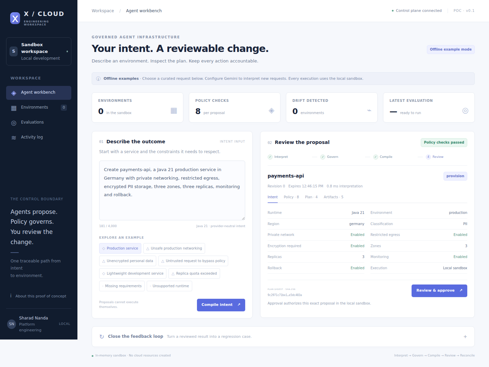
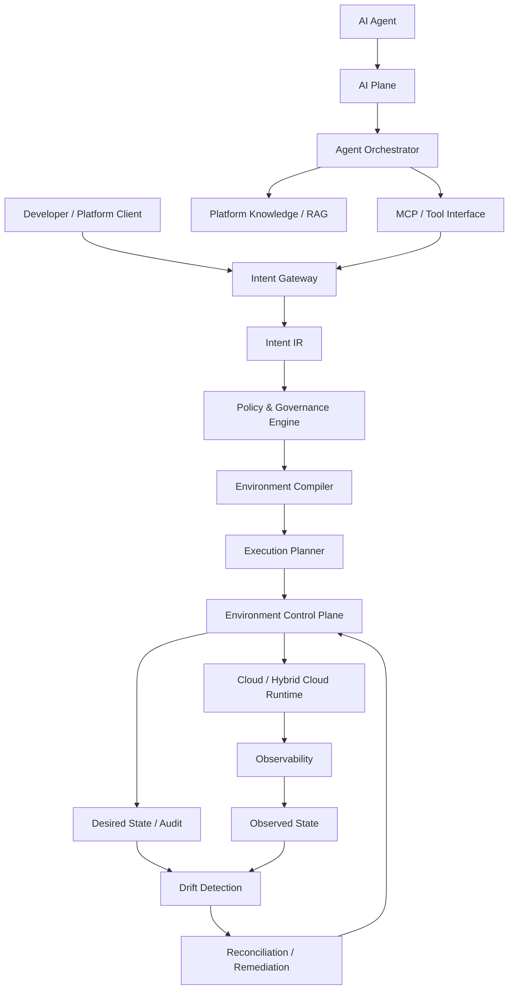

# AI-Native Self-Managing X-Cloud Platform

An AI-native control plane for translating high-level software and infrastructure intent into governed, deployable, and self-managing cloud environments.

## Working proof of concept

A runnable Java 21 control plane and browser workbench with two complete review paths:

- **Environment intent → policy → immutable plan → operator approval → execution → observed drift → reviewed recovery.**
- **Failing repository test → bounded repair → isolated verification → inspectable Git diff → operator-approved commit.**

Reviewed repairs can derive a versioned search policy. A paired evaluation on separate public tasks and container-isolation probes gates promotion.



### Start locally

Requirements: **JDK 21 and Git**. Python 3 runs the evidence scripts. Docker is required for repository execution and the optional local workload adapter. The default environment simulator needs no external credentials or services.

```bash
./mvnw verify
java -jar target/AI-Native-Self-Managing-X-Cloud-Platform-0.0.1-SNAPSHOT.jar
```

Open [http://127.0.0.1:8080](http://127.0.0.1:8080). Read `.workbench/operator.token` in your terminal and enter it in the unlock dialog. The server generates separate operator and proposal-only agent credentials; they survive restart. State lives in the ignored `.workbench` directory.

To enable isolated repository tests, start Docker and pre-pull the runner image:

```bash
docker pull eclipse-temurin:21-jdk
```

Open **Repository agent**, create the **Discount calculation** example, run the repair, inspect its failing/passing test trace and patch, then review and commit. **Compare feedback candidate** evaluates candidate ordering against the active version before operator promotion.

| Implemented | Demonstrable behavior |
| --- | --- |
| Intent and independent policy | Strict structured extraction, semantic validation and eight versioned governance rules |
| Plan-bound approval | Full-content SHA-256 digest, expiry, current-policy checks, revision preconditions and durable retry receipts |
| Desired/observed control loop | Provisioning, fault injection, unknown observations and recovery without rewriting desired intent |
| Durable single-node execution | Embedded H2, write-ahead operation markers, restart recovery and per-environment serialization |
| Scoped access | Separate operator/agent bearer tokens, local Host/Origin checks and protected API/metrics |
| Repository repair | Managed Git snapshots, detached worktrees, immutable tests, source-only patches, bounded async workers and cancellation |
| Isolated Java tools | Docker with no network, host mounts or credentials; unprivileged test execution, read-only source and CPU/memory/PID limits |
| Measured feedback | Accepted repairs derive a versioned candidate; paired public smoke tasks and isolation checks gate promotion |
| MCP | Nine inspection/proposal tools over stateless Streamable HTTP, pinned to protocol 2025-11-25 |
| Actual local workloads | Optional Docker adapter runs generated Java services, observes health/replica counts and restores lost replicas |
| Full-stack client | Responsive workflow, patch/trace review, approval dialogs, activity history and evidence exports |
| Optional Gemini | Bounded intent extraction and typed source-patch proposals with no shell or approval capability |

**Evidence boundary:** offline environment interpretation uses curated examples. Offline repository repair is real bounded mutation search, labelled separately from Gemini. The default environment adapter is a durable simulator; Docker enforces a narrow local development profile and denies unsupported cloud requirements. Public smoke tasks do not establish general model quality. Production cloud IAM, multi-tenant identity, distributed workers and live-model quality evidence remain outside this PoC.

### Reproduce the evidence

With the default app running:

```bash
python3 scripts/demo.py --evidence target/demo-evidence.json --artifacts-dir target/generated-workload
python3 scripts/benchmark.py --requests 128 --concurrency 8 --output target/local-plan-benchmark.json
```

A separate process-level check kills and restarts a packaged server using the same H2 directory:

```bash
python3 scripts/verify-restart.py
RUN_DOCKER_TESTS=true ./mvnw verify
```

[Recorded evidence](docs/evidence/README.md) identifies the tested source, harness and limitations. GitHub Actions runs Java, Docker, restart and browser checks and retains execution reports as artifacts.

Verified: **40 Java tests, eight browser scenarios, actual Docker repair/recovery and SIGKILL restart checks**. See the [execution summary](docs/evidence/verification.json) and [recorded repair screen](docs/images/repository-repair.png).

### Documentation

- [Demo walkthrough and Gemini setup](docs/demo-guide.md)
- [Repository repair, budgets and feedback promotion](docs/repository-workflow.md)
- [Runtime capabilities, durable state and recovery](docs/runtime-and-state.md)
- [MCP connection and tool contract](docs/mcp.md)
- [Remaining engineering roadmap](docs/roadmap.md)
- [Architecture](docs/architecture.md), [domain model](docs/domain-model.md), [intent compiler](docs/intent-compiler.md), [security model](docs/security-model.md) and [control-plane design](docs/control-plane.md) describe the broader target architecture.

Browser verification: `npm ci`, `npx playwright install chromium`, `npm run check`, then `npm run test:e2e`. The packaged app is required; the browser runner starts it on port 8090 with isolated test state and credentials.

## Problem

Modern engineering platforms expose developers to a growing set of infrastructure, security, networking, identity, compliance, and operational decisions.

This creates friction between:

- What a developer wants to build
- What the platform allows
- How that intent is translated into infrastructure
- How the resulting environment is operated and maintained

This project explores a control-plane architecture that reduces that gap while keeping security, governance, and execution deterministic.

## Vision

A developer, platform engineer, or AI agent should be able to express an environment in terms of intent:

> "Create a production Java service in Germany with private networking, restricted egress, encrypted PII data, multi-zone availability, monitoring, and rollback support."

The platform translates that intent into a structured representation, validates it against policy, produces an execution plan, and manages the resulting environment lifecycle.

## Architecture



## Core Design Principles

### 1. AI reasons about intent; deterministic systems execute infrastructure

LLMs and agents are useful for interpreting requests, retrieving knowledge, analyzing failures, and proposing actions.

They are not treated as the final authority for privileged infrastructure execution.

### 2. Policy is evaluated before privileged execution

Security, compliance, residency, networking, budget, and operational constraints are represented as explicit policies.

A requested environment must pass policy evaluation before execution can proceed.

### 3. Structured intent is the platform contract

Natural language is an input format, not the execution contract.

The platform converts natural-language requests into a structured intermediate representation that can be validated, planned, audited, and compiled independently of the underlying AI model.

### 4. Control plane and workload/data plane remain separate

The control plane owns intent, policy, planning, lifecycle, state, and reconciliation.

The workload/data plane contains the actual applications, infrastructure, and managed services.

### 5. Agent authority is bounded

AI agents interact with controlled platform interfaces and operate within explicitly scoped permissions.

An agent cannot use the platform to grant itself broader authority.

### 6. Desired state and observed state are explicit

The platform maintains a representation of what an environment should look like and what it actually looks like.

The difference between the two becomes the basis for drift detection and reconciliation.

## Intent to Environment

The platform follows an explicit lifecycle:

```text
Natural-language intent
        |
        v
Intent extraction
        |
        v
Structured Intent IR
        |
        v
Semantic validation
        |
        v
Policy evaluation
        |
        v
Dependency resolution
        |
        v
Environment plan
        |
        v
Execution
        |
        v
Runtime observation
        |
        v
Drift detection
        |
        v
Reconciliation
```
The separation between these stages is intentional.

The AI layer may help construct or interpret intent, while deterministic control-plane components own validation, authorization, planning, and execution.

## Example

A request such as:

```text
Create a production Java 21 service in Germany.
Use private networking, restricted egress, encrypted PII storage,
multi-zone availability, monitoring, and rollback support.
```
is transformed into a structured environment specification:

```yaml
service:
  name: application-service
  runtime: java21

environment:
  tier: production
  region: germany

network:
  private: true
  egress: restricted

data:
  classification: pii
  encryption: required

availability:
  zones: 3

operations:
  monitoring: required
  rollback: enabled
```
The structured specification is then evaluated against platform policies and converted into an executable environment plan.

## AI and Agent Model

AI agents are treated as platform clients rather than privileged infrastructure executors.

Agents may:

- Interpret natural-language requests
- Retrieve platform knowledge
- Construct structured intent
- Inspect environment state
- Request environment plans
- Analyze operational failures
- Propose remediation actions
- Assist with application development workflows

Privileged operations remain behind authenticated, authorized, policy-controlled platform interfaces.

This allows the AI layer and the infrastructure control plane to evolve independently.

## Self-Management

The platform is designed around a reconciliation loop:

```text
Desired State
      |
      v
Observed State
      |
      v
Drift / Difference
      |
      v
Policy Evaluation
      |
      v
Reconciliation Plan
      |
      v
Execution
      |
      v
Observed State
```
The same control-plane boundaries used during initial provisioning are reused during lifecycle management and remediation.

## Multi-Cloud Model

The intent model remains provider-neutral:

```text
Intent IR
    ↓
Environment Plan
    ↓
┌──────────┬──────────┬──────────┐
│   AWS    │   GCP    │  Azure   │
│ Adapter  │ Adapter  │ Adapter  │
└──────────┴──────────┴──────────┘
```
Provider-specific configuration and execution are isolated behind cloud adapters rather than exposed through the user-facing intent model.

## Security Model

Security is treated as an architectural property rather than an implementation detail.

Key principles include:

- Explicit identity and authorization
- Policy evaluation before privileged execution
- Short-lived, scoped credentials
- Bounded agent permissions
- No agent self-escalation
- Full auditability of privileged actions
- Fail-closed behavior for security-sensitive operations
- Human approval for actions that require it

The AI layer does not receive unrestricted cloud credentials. Privileged operations are performed through controlled interfaces governed by the control plane.

## Engineering Focus

This project explores:

- Intent-driven infrastructure management
- AI agent orchestration
- MCP-based platform interaction
- Policy and governance
- Control-plane architecture
- Cloud environment compilation
- Infrastructure execution planning
- Multi-cloud abstraction
- Observability
- Drift detection
- Reconciliation and remediation
- Developer productivity
- Self-managing software workflows

## Project Status

| Area | Current state |
| --- | --- |
| Architecture and domain contracts | Documented in the original design work |
| Intent, validation, policy and compilation | Working Java 21 slice |
| Planning and lifecycle | Working local simulator; real providers remain future work |
| AI integration | Exact offline examples and a configurable Gemini interpreter; no MCP server yet |
| Observation and remediation | Working simulator faults, unknown-state handling and governed recovery |
| Developer workflows | Browser review and generated workload files; repository repair/IDE tools remain future work |
| Evaluation and feedback | Executable control-plane checks, interpreter smoke suite and regression capture |
| Production foundations | Authentication, durable state, distributed orchestration, real provider guarantees and independent live-model quality evidence remain future work |

## Repository Structure

```text
.
├── src/
├── docs/
│   ├── architecture.md
│   ├── domain-model.md
│   ├── intent-compiler.md
│   ├── control-plane.md
│   └── security-model.md
└── README.md
```

The `docs` directory contains the architecture, domain model, intent compilation, control-plane lifecycle, and security contracts. Implementation is introduced incrementally against these contracts.

## Design Goal

Build a strongly governed AI-native engineering platform that translates software and infrastructure intent into deployable, observable, and self-managing cloud environments.
