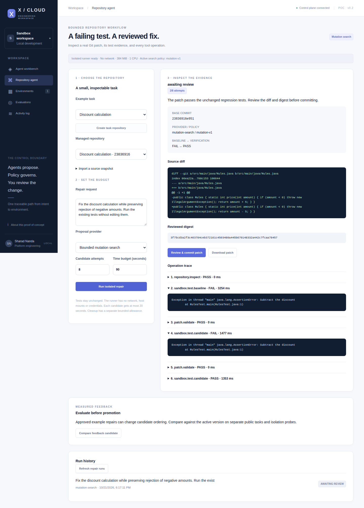
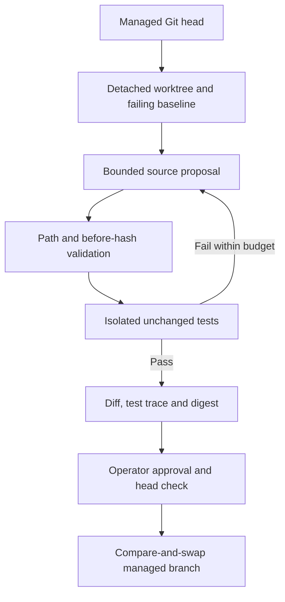

# Governed repository repair

## Contract

The operator creates a managed Git snapshot from a catalog task or `POST /api/code/repositories` with `{name, files, testClass}`. `files` maps relative paths to UTF-8 content. Accept 2-24 files, at most 200 KB total and 32 KiB per file, under `src/main/java` or `src/test/java`. The test entrypoint is an existing Java class with a `main` method. The import boundary excludes symlinks, Git metadata, build scripts, package managers and arbitrary clone URLs.

An agent may call `POST /api/code/runs` with repository ID, instruction, provider, attempt count and timeout. Two workers consume a bounded queue of sixteen. The server retains at most 200 runs and 25 repositories. Runs persist before work begins. A stopped worker becomes `INTERRUPTED` after restart; it is never automatically replayed.

Only existing `src/main/java` files can change: up to five replacements, 65,536 replacement bytes in total, matching original SHA-256 hashes. Test files and tool configuration remain immutable. Passing tests establish agreement with the supplied regression suite; they do not prove full semantic correctness.

## Isolation and budgets

| Control | Enforced behavior |
| --- | --- |
| Network and host | Docker `network=none`, no host mounts, no daemon socket, no forwarded credentials |
| Privilege | Test commands run as UID/GID 10001; all capabilities dropped; no privilege escalation |
| Filesystem | Read-only root, root-owned read-only source; bounded workspace and temporary tmpfs |
| Resources | One CPU, 384 MiB memory/no swap growth, 96 PIDs, 128 file descriptors |
| Tool | Fixed Java 21 compile/test command; annotation processing disabled; no repository scripts |
| Output | Retain at most 64 KiB and fail truncated test evidence |
| Search | 1-12 candidates; Gemini at most three calls and 4,096 output tokens per call |
| Time | 20-120 seconds per run; at most twenty seconds per test process; bounded initialization/cleanup allowance |
| Cancellation | Interrupt the active tool and forcibly remove its disposable container; queued cancellation prevents execution |

The host process boundary selects Git or Docker from a fixed executable allowlist. Repository IDs resolve to retained server identities, and Git uses an explicit managed directory argument. Model output cannot select a host executable, shell, or working directory.

The Docker daemon is trusted and powerful. This is a local single-operator PoC, not a hostile multi-tenant execution service. Kernel isolation and Docker limits do not replace a microVM boundary. No host-JVM execution fallback exists. Pre-pull the configured image; requests cannot pull arbitrary images. Set `platform.sandbox.image` to a reviewed immutable image digest for reproducible deployments.

## Providers and evidence

`mutation-search` enumerates single-token boundary, equality and arithmetic edits while skipping comments and string literals. Every proposed candidate actually runs through validation and tests. It is deterministic bounded search, not fixture test output or generative inference.

`gemini` returns typed source replacements. It receives only the bounded task snapshot and test history. Missing configuration fails explicitly. Invalid JSON, scope violations and incomplete model output fail the run. A passing candidate produces a complete diff, test result, original head and full-content review digest.

Approval requires an operator credential, reviewable state, matching digest and unchanged base commit. The worktree is reconstructed, the exact diff is rechecked, and Git's `update-ref` compares the original head before updating the managed branch. A durable `APPLYING` marker precedes the update. Restart recognizes a completed commit by its parent and review trailer; uncertain work becomes interrupted. The managed snapshot is separate from the platform's source repository.

## Measured feedback

Only operator-approved catalog feedback tasks contribute mutation-category frequencies. Imported snapshots and evaluation tasks cannot contribute through this path. The derived candidate has an immutable version and training-run IDs. It changes candidate ordering only; it cannot change tests, tool permissions, environment policy or approval requirements.

A comparison freezes the current baseline and candidate, then runs each on the same separate public task set. Reports retain task outcomes, attempt counts, durations and patch digests. Safety probes reject test/path changes and execute a real container check for network isolation, source immutability and absence of credentials/daemon socket.

Promotion requires complete paired results, all safety probes passing, all baseline/candidate tasks passing, strictly fewer candidate attempts, and an unchanged active baseline. A failed or inconclusive comparison cannot promote. This small public smoke set measures bounded search efficiency; repeated evaluation can overfit it, and it is not a blind benchmark or model-training claim.
